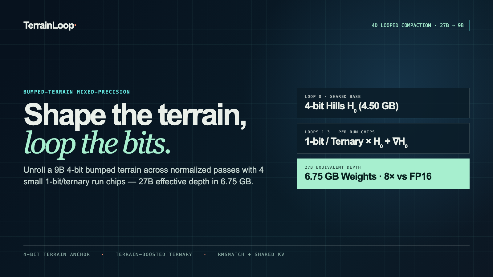
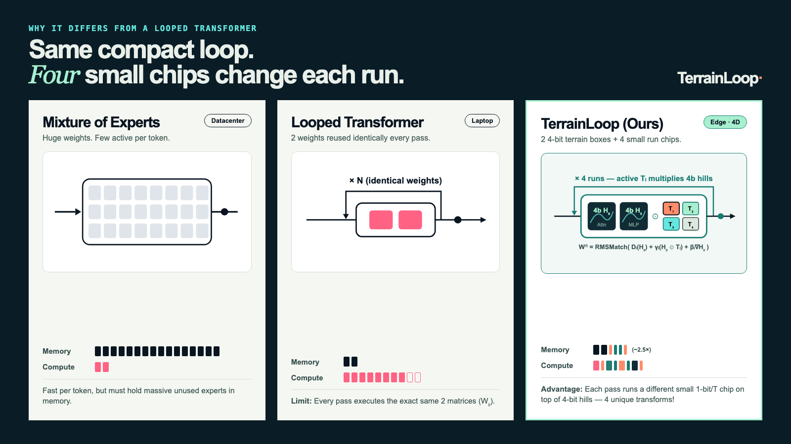
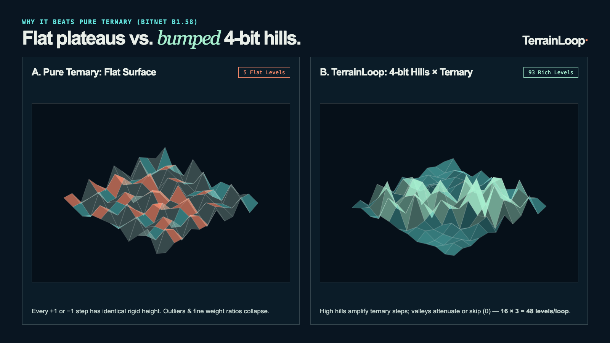

# TerrainLoop

**Shape the terrain, loop the bits.**  
*Bumped-Terrain 4D Looped Compaction for 27B → 9B Local Language Models*

---

## Core Idea

> Unrolling a shared 9B 4-bit terrain backbone across normalized passes—guided by lightweight 1-bit/ternary per-run modifiers and cross-loop KV sharing—delivers **27B-equivalent compute depth** in **~6.75 GB** of weight memory while keeping fine-grained weight geometry intact.

Pure 1-bit and ternary models force every weight onto a **flat surface**, crushing outlier channels and typically requiring trillions of tokens from scratch. Standard Looped Transformers keep memory small, but repeat the **exact same weights** identically on every pass.

**TerrainLoop** treats layer depth as a **4th dimension**:
- **Loop 0** keeps a warm-started **4-bit bumped terrain** as the shared carrier of precision and outliers.
- **Loops 1–3** attach **small 1-bit/ternary modifier chips** that multiply by the local terrain height and slope—turning rigid ternary steps into rich, hill-amplified transformations on every run.

---

## How It Differs from MoE & Standard Looped Transformers

---

## Flat Ternary Plateaus vs. Bumped 4-Bit Terrain

- **On high hills:** small ternary/1-bit steps produce large, expressive feature shifts.
- **In valleys:** steps stay subtle—or `0` skips unchanged weights at zero update energy.
- **Across depth:** energy normalization and cross-loop KV sharing prevent variance explosion and 3× KV-cache bloat.

---

## At a Glance (27B Depth Target)

| Configuration | Core Footprint | Weight Storage | Runtime KV Cache |
|---|---:|---:|---:|
| Dense 27B (FP16) | 27B | 54.00 GB | 27B-layer |
| Dense 27B (INT4) | 27B | 13.50 GB | 27B-layer |
| **TerrainLoop 9B × 3 (4b + 1b + 1b)** | **9B core** | **6.75 GB** | **9B-layer (shared)** |
| **TerrainLoop 9B × 3 (4D-Factored)** | **~9B total** | **4.95 GB** | **9B-layer (shared)** |

---

## Read & Explore

- **[Interactive Site & 3D Workbench](https://emircanerkul.github.io/terrainloop/)** — Orbit the 3D Flat vs. Bumped terrains, inspect the 4D trajectory sphere, and explore the `27B → 9B` calculator
- **[Full Paper (PDF)](terrainloop-final-paper.pdf)** — Complete formulation, 5 architectural fixes, evaluation controls, and roadmap
- **[Full Paper (Markdown)](terrainloop-final-paper.md)** — Source technical paper
- **[Executive Summary](SUMMARY.md)** — High-level overview
- **[Website Source](terrainloop/)** — Standalone HTML/CSS/JS showcase
