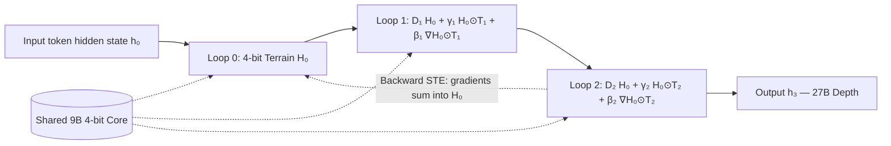

# TerrainLoop: Bumped-Terrain 4D Looped Compaction for 27B → 9B Language Models

## Abstract

Deep transformer deployments are bottlenecked by parameter storage, memory-bandwidth traffic during autoregressive decoding, and KV-cache growth across depth. Existing compression paradigms—uniform INT4 quantization, low-rank adaptation, structural pruning, and flat 1-bit or 1.58-bit ternary networks—treat each layer as an independent 3D slice or flatten all weights onto uniform low-bit plateaus. This paper proposes **TerrainLoop**, a 4D looped-stack architecture that unifies parameter sharing across layer depth $i$ with **terrain-coupled mixed precision** (`4-bit + 1-bit/ternary + 1-bit/ternary`).

Instead of training three independent 9B blocks (27B total) or collapsing every layer to flat ternary levels $\{-1, 0, +1\}$, TerrainLoop stores a single **9B 4-bit base backbone ($H_0$)** that acts as a 16-level *bumped terrain*. Subsequent looped passes ($i=1, 2$) apply deterministic zero-bit 4D coordinate rotations $\mathcal{D}_i(H_0)$ combined with lightweight **1-bit or ternary masks ($T_1, T_2$)** whose effective magnitudes are amplified by the local hill elevation $H_0$ and local terrain slope $\nabla_i H_0$, stabilized by per-loop RMS normalization. Together with cross-loop KV sharing, a 3-loop TerrainLoop model delivers **27B-equivalent sequential compute depth** in **6.75 GB** of weight memory (or **~4.7–5.0 GB** with 4D-factored masks) while remaining warm-startable from pretrained 9B checkpoints.

## 1. Introduction

Standard dense transformers store separate parameter matrices $W_0, W_1, \dots, W_{L-1}$ across $L$ layers. From a geometric perspective, each layer is a slice along a **4th dimension — depth $i$**. Treating consecutive depth slices as statistically independent forces a 27B model to allocate 54 GB in FP16 or 13.5 GB in INT4 even though adjacent layers share strong structural priors and operate on a slowly evolving residual stream.

```text
3D slice view:   W⁽⁰⁾, W⁽¹⁾, W⁽²⁾ stored independently  →  3× storage, 3× bandwidth
4D looped view:  H₀ (4-bit hills) + D_i(H₀) + T_i (1-bit/ternary)  →  1× core + lightweight modulators
```

At the opposite extreme, pure 1-bit ($\{-1, +1\}$) and ternary ($\{-1, 0, +1\}$, 1.58-bit) models reduce storage aggressively, but impose a **flat terrain**: every non-zero weight has identical scale $\pm\alpha$. That flat geometry destroys outlier channels, collapses fine sensitivity ratios, and typically demands training from random initialization over trillions of tokens.

TerrainLoop bridges both regimes by separating two responsibilities across the 4th dimension:

1. **Loop 0 ($i=0$) carries precision and outliers.** A 4-bit quantized backbone $H_0$ (16 levels per weight) preserves ~98–99% of a pretrained 9B model's geometry.
2. **Loops 1 & 2 ($i=1, 2$) carry functional divergence.** Lightweight 1-bit or ternary masks $T_1, T_2$ ride on top of $H_0$ via hill-height multiplication, terrain-slope shifts, and deterministic 4D rotations.

## 2. Looped = Stacked Across the 4th Dimension

Unrolling a shared transformer core $K=3$ times ($i \in \{0, 1, 2\}$) with iteration-conditioned weight transformations is functionally equivalent to a $3$-fold stacked network whose weights obey a **compact 4D generative law**:



A naive 4D trajectory sketch such as $P(i) = P(0) + i \cdot (1, 1, 2)$ fails for real neural networks: norms diverge linearly across loops (`3.74 → 6.13 → 8.54`), every step pushes along the same line, and arbitrary decimals do not sit on a 4-bit grid. A valid 4D formulation must be **quantized at $i=0$**, **energy-bounded across $i$**, and **subspace-diverse**.

Using a 4-bit anchor $H_0 = 0.25 \times (+5, -3, +6) = (+1.25, -0.75, +1.50)$ ($\|H_0\|_2 = 2.092$), norm-preserving 3D rotations $\mathcal{D}_i$, terrain-scaled ternary steps ($\gamma = 0.40$), and per-loop normalization produce:

| Loop $i$ | Deterministic Rotation $\mathcal{D}_i(H_0)$ | Ternary Mask $T_i$ | Terrain-Scaled Step $0.40(H_0 \odot T_i)$ | Normalized $W(i)$ | Norm $\|W(i)\|_2$ |
|---|---|---|---:|---|---:|
| **$i=0$ (4-bit Base)** | $(+1.25,\ -0.75,\ +1.50)$ | — | — | $(+1.25,\ -0.75,\ +1.50)$ | **2.092** |
| **$i=1$ (Rot + $T_1$)** | $(+0.10,\ -0.75,\ +1.95)$ | $(+1,\ 0,\ -1)$ | $(+0.50,\ 0.00,\ -0.60)$ | $(+0.76,\ -0.95,\ +1.70)$ | **2.092** |
| **$i=2$ (Rot + $T_2$)** | $(+0.10,\ -1.77,\ +1.11)$ | $(-1,\ +1,\ +1)$ | $(-0.50,\ -0.30,\ +0.60)$ | $(-0.31,\ -1.60,\ +1.32)$ | **2.092** |

## 3. How TerrainLoop Differs from a Standard Looped Transformer

A standard **Looped Transformer** shrinks memory to 2 compact blocks (Attention + MLP) and reuses those exact same matrices identically across $\times N$ passes. While weight memory stays tiny, every iteration applies the same operator, making it hard for later passes to specialize without bloating parameters.

**TerrainLoop** keeps the 2 shared 4-bit terrain boxes ($H_0$) and attaches **4 small 1-bit/ternary modifier chips** so each pass activates its own lightweight modifier over the shared hills. Memory increases only slightly (2 base blocks + 4 thin modifier strips), yet each loop computes a genuinely distinct transformation.

### Why Sparse Diffs Carry High Expressive Power

Consider encoding four distinct statements from one anchor plus tiny $+ / 0 / -$ diffs:

| Run / Pass | Slot 1 (Entity) | Slot 2 (Polarity) | Slot 3 (Domain) | Resulting Meaning |
|---|---|---|---|---|
| **Base (4-bit)** | `App` | `is` | `software` | **“App is software”** |
| **Run 1 (Chip 1)** | `+le` | `+n't` | `0` (skip) | **“Apple isn't software”** |
| **Run 2 (Chip 2)** | `+t` | `-n't` | `0` (skip) | **“Applet is software”** |
| **Run 3 (Chip 3)** | `0` (skip) | `0` (skip) | `+_layer` | **“Applet is software layer”** |

Here `0` skips unchanged heavy concepts (`software`) at zero update cost, while small `+` and `-` diffs invert truth polarity and refine entity specificity. In transformer weights, multiplying ternary masks ($\{-1, 0, +1\}$) by 4-bit hills ($16$ levels) produces $16 \times 3 = 48$ terrain-scaled levels per run instead of 3 flat slabs.

## 4. Flat Surface vs. Bumped Terrain

Why does coupling a 1-bit or ternary layer to a 4-bit base outperform stacking flat ternary layers?

- **Flat Surface (BitNet / Pure Ternary):** Every weight position starts at a uniform plateau $\alpha_0$. Adding $T_1, T_2 \in \{-1, 0, +1\}$ yields $W_{\text{flat}} = \alpha_0 + \gamma T_1 + \gamma T_2$, producing at most **3 to 5 rigid levels**. Small noisy weights and critical outlier weights receive the exact same step size $\gamma$.
- **Bumped Terrain (TerrainLoop):** Layer 0 defines a 16-level elevation surface $H_0$. Multiplying $T_i$ by the local elevation $H_0$ and local slope $\nabla_i H_0$ scales every binary/ternary decision by the terrain underneath:
  - **On a Hill ($|H_0| \approx 2.0$):** $T_i = \pm 1$ moves the weight by $\pm 2.0\,\gamma$, driving strong specialized features.
  - **In a Valley ($|H_0| \approx 0.2$):** $T_i = \pm 1$ only nudges the weight by $\pm 0.2\,\gamma$, and $T_i = 0$ leaves the valley undisturbed.
  - **Across Slopes ($\nabla_i H_0$):** Neighboring differences break symmetry and steer weights into new subspaces without storing extra high-bit matrices.

As a result, each ternary or 1-bit mask on a 4-bit terrain yields **30–80+ distinct effective weight levels** rather than 3 flat slabs.

## 5. Mathematical Formulation & Training Dynamics

For loop index $i \in \{1, 2\}$, the effective weight tensor $W^{(i)}$ is constructed on the fly from the shared 4-bit terrain $H_0 = \alpha_0 Q_4$:

$$W_{\text{raw}}^{(i)} = \mathcal{D}_i(H_0) + \gamma_i \big(H_0 \odot T_i\big) + \beta_i \big(\nabla_i H_0 \odot T_i\big)$$

$$W^{(i)} = \text{RMSMatch}\!\left(W_{\text{raw}}^{(i)},\ H_0\right), \qquad \text{RMSMatch}(A, B) = A \cdot \frac{\text{RMS}(B)}{\text{RMS}(A) + \epsilon}$$

Here $\mathcal{D}_i$ is a zero-parameter deterministic 4D transform (e.g., cyclic channel permutation or Fast Walsh-Hadamard rotation indexed by $i$), $\nabla_i H_0 = \mathcal{S}_i(H_0) - H_0$ is the deterministic terrain slope along a shifted axis, and $\gamma_i, \beta_i$ are learnable per-layer scalars.

### Forward and Backward Flow

During the forward pass, the residual hidden state advances across all three stacked loops:

$$h_1 = h_0 + \text{Block}\big(\text{RMSNorm}_0(h_0);\ W^{(0)}\big)$$
$$h_2 = h_1 + \text{Block}\big(\text{RMSNorm}_1(h_1);\ W^{(1)}\big)$$
$$h_3 = h_2 + \text{Block}\big(\text{RMSNorm}_2(h_2);\ W^{(2)}\big)$$

During backpropagation via the Straight-Through Estimator (STE), gradients from all three passes **sum into the shared 4-bit terrain master weights**:

$$\nabla_{H_0}\mathcal{L} = \sum_{i=0}^{2} \left(\frac{\partial \mathcal{L}}{\partial W^{(i)}} \cdot \frac{\partial W^{(i)}}{\partial H_0}\right)$$

Meanwhile, $T_1$ and $T_2$ receive gradients proportional to $H_0$ and $\nabla_i H_0$, allowing **hill weights to switch polarity rapidly** while near-zero valley weights remain stable.

## 6. Accounting for 27B → 9B Compaction

Compacting a 27B dense depth profile into a 9B core requires accounting for **both** weight storage and runtime KV cache:

| Model Representation | Core Params | Precision Layout | Weight Memory | Runtime KV Cache | Effective Depth |
|---|---|---|---:|---:|---:|
| Dense 27B (FP16) | 27B | 16-bit | 54.00 GB | 27B-layer KV | 27B |
| Dense 27B (INT4) | 27B | 4-bit | 13.50 GB | 27B-layer KV | 27B |
| Pure Ternary 27B (BitNet b1.58) | 27B | 1.58-bit packed | 5.33 GB | 27B-layer KV | 27B |
| **TerrainLoop 9B × 3 (Dense 1-bit)** | **9B core** | **4-bit + 1-bit + 1-bit** | **6.75 GB** | **9B-layer KV (shared)** | **27B** |
| **TerrainLoop 9B × 3 (Dense Ternary)** | **9B core** | **4-bit + 1.58b + 1.58b** | **8.06 GB** | **9B-layer KV (shared)** | **27B** |
| **TerrainLoop 9B × 3 (4D-Factored 20%)** | **~9B total** | **4-bit + factored 1-bit** | **4.95 GB** | **9B-layer KV (shared)** | **27B** |

### Memory Budget Breakdown (Dense `4b + 1b + 1b`)

- **Loop 0 ($9\text{B} \times 4\text{ bits}$):** $4.50\text{ GB}$
- **Loop 1 ($9\text{B} \times 1\text{ bit}$):** $1.125\text{ GB}$
- **Loop 2 ($9\text{B} \times 1\text{ bit}$):** $1.125\text{ GB}$
- **Total weights:** **$6.75\text{ GB}$** (**8× smaller** than 27B FP16; **2× smaller** than 27B INT4), excluding group quantization scales and unlooped embedding/LM-head tables (~0.5–1.2 GB at 4–8 bit depending on vocabulary size).

## 7. Five Architectural Gaps & Design Fixes

| Gap in Naive Looped Mixed-Precision | Failure Mode | TerrainLoop Solution |
|---|---|---|
| 1. Additive/multiplicative variance growth | Weight variance scales as $(1+\gamma_1^2+\gamma_2^2)\sigma^2$, causing activation explosion | **Per-Loop RMSNorm** on activations + **RMSMatch** rescaling on $W^{(i)}$ |
| 2. 3× KV-cache expansion | Unrolling 9B layers 3× creates 3× virtual attention layers in KV memory | **Cross-Loop KV Sharing** (Loops 1 & 2 attend over Loop 0 / GQA-shared KV states) |
| 3. Same-subspace collapse | Pure elementwise scaling preserves row/column eigenvectors | **Deterministic 4D Rotation / Slope ($\mathcal{D}_i, \nabla_i H_0$)** rotates channels per loop |
| 4. Valley sign-flip noise | Pure 1-bit `{-1,+1}` forces near-zero weights to fire every loop | **Ternary `{-1,0,+1}`** (or terrain-thresholded 1-bit) lets valleys stay `0` |
| 5. Coupled QAT oscillation | Moving 4-bit base and 1-bit masks simultaneously causes STE instability | **Warm-start $H_0$** from a pretrained 9B INT4/BF16 model; anneal $T_1, T_2$ first |

## 8. Evaluation Methodology

TerrainLoop must be tested against matched-compute and matched-memory controls rather than raw parameter-count claims:

| Baseline / Configuration | What It Isolates |
|---|---|
| Pretrained 9B (INT4, 1 pass) | Single-pass quality and latency floor |
| Looped 9B × 3 (Shared weights, no modulators) | Value of extra depth without terrain-coupled 1-bit/ternary masks |
| Flat Ternary 27B (BitNet b1.58) | Benefit of 4-bit bumped terrain + warm-start vs flat ternary from scratch |
| Dense 27B (INT4) | Target quality ceiling at 2× weight memory and 3× KV cache |
| TerrainLoop 9B × 3 (4b + 2×1b / 2×T) | Full proposed architecture with RMSMatch and cross-loop KV sharing |

Measurements must report perplexity, reasoning pass@1, general-task regression, weight bytes, peak VRAM (including KV cache at 8k–32k context), tokens/sec, and dequantization kernel overhead.

## 9. Research Risks & Design Corrections

- **Compute vs. Memory:** Looping 9B weights 3 times cuts weight memory and memory-bandwidth traffic by ~2× relative to 27B INT4, **not** FLOPs. Arithmetic compute remains comparable to a 27B pass, making TerrainLoop ideal for **memory-bandwidth-bound local inference** (low batch sizes) rather than compute-bound batch serving.
- **Unlooped Layers:** Token embeddings and the LM head execute once per token and remain ~9B-scale; their storage must be accounted for separately.
- **Kernel Support:** On-the-fly terrain modulation $H_0 \odot (1 + \gamma_i T_i)$ should be fused inside the dequantization-matmul tile kernel so $W^{(1)}$ and $W^{(2)}$ are never materialized as full FP16 matrices in HBM/VRAM.

## 10. MVP Roadmap

**Phase 1 — Stabilize a 1B–3B Prototype:** Warm-start a pretrained 1.5B–3B model, quantize $H_0$ to 4-bit, attach per-loop RMSNorm + $\mathcal{D}_i$ + ternary $T_1, T_2$, and verify training convergence and variance stability across 3 loops.

**Phase 2 — Controlled 27B vs. 9B Benchmark:** Compare TerrainLoop (`9B × 3`) against a 9B single-pass baseline, a flat looped 9B, and a 27B INT4 model on reasoning, coding, and long-context memory footprint with cross-loop KV sharing enabled.

**Phase 3 — 4D Mask Factorization & Fused Kernels:** Factor $T_1, T_2$ along the 4th dimension (Kronecker / block-low-rank masks) and implement fused 4-bit + ternary CUDA/Metal kernels to realize real decoding speedups on consumer GPUs and Apple Silicon.

## 11. Conclusion

TerrainLoop reframes model compression from flattening weights in 3D to **shaping trajectories in 4D**: keep one warm-started 4-bit bumped terrain as the shared carrier of precision and outliers, and let ultra-lightweight 1-bit/ternary modulators surf its hills and slopes across stacked loops.

## References

1. Ma et al. [The Era of 1-bit LLMs: All Large Language Models are in 1.58 Bits](https://arxiv.org/abs/2402.17764).
2. Dehghani et al. [Universal Transformers](https://arxiv.org/abs/1807.03819).
3. Giannou et al. [Looped Transformers as Programmable Computers](https://arxiv.org/abs/2301.13196).
4. Lin et al. [AWQ: Activation-aware Weight Quantization for LLM Compression and Acceleration](https://arxiv.org/abs/2306.00978).
5. Brandon et al. [Reducing Transformer Key-Value Cache Size with Cross-Layer Attention](https://arxiv.org/abs/2405.12981).
6. Dettmers et al. [QLoRA: Efficient Finetuning of Quantized LLMs](https://arxiv.org/abs/2305.14314).
